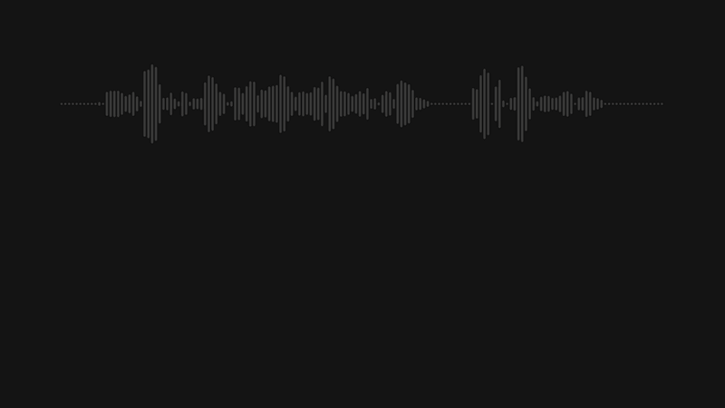
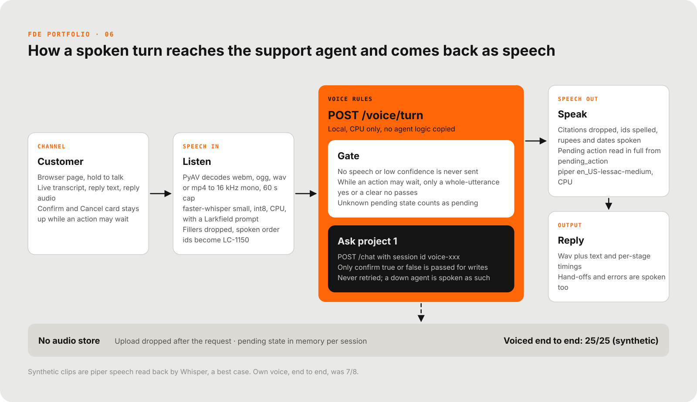
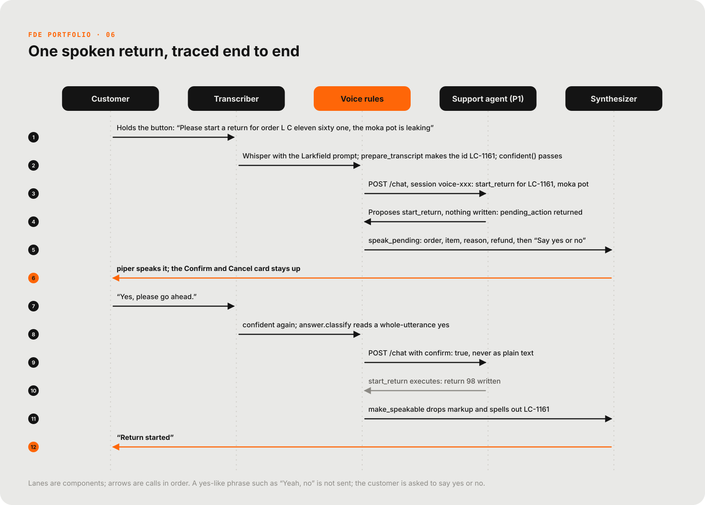

# Larkfield voice intake

A voice front end for the Larkfield support agent (project 1), for customers who would rather speak than type: hold a button, talk, and hear the answer. Returns and tickets still wait for a Confirm, and the agent hands off when unsure. Larkfield Coffee Co. is fictional and everything here is simulated.

[](docs/media/reel.mp4)
<sub>29-second reel. Click for the full video.</sub>

| Voiced end to end | Spoken order ids | Quiet clips |
|---|---|---|
| **25/25** voiced requests reach the right tool and order id, end to end against the real agent (synthetic clips, run 3; `evals/report.md`) | **17/17** spoken order ids correct after normalisation (synthetic clips; own voice 4/5; `evals/report.md`) | **5/5** quiet clips never reach the agent: silence, noise, laughter, babble, keyboard (synthetic; `evals/report.md`) |

Own voice, end to end: 7/8 spoken, 8/8 typed (`evals/results/e2e-own-run2.json`). Synthetic clips are piper speech read back by Whisper, a best case; see the caveats below.

## The problem

Larkfield's older buyers and people on the move phone or message instead of typing. The typed support agent already answers, looks up orders, and starts returns and tickets after a confirmation. The ask: let a customer talk to that same agent and hear the answer, without a spoken "yeah, no" ever starting a return (`docs/engagement.md`).

## Architecture



- Everything runs locally on CPU: faster-whisper `small` (int8) for speech to text, piper `en_US-lessac-medium` for text to speech. The GPU stays free for the agent's model.
- The brain is project 1, called over HTTP. No agent logic is copied, so the typed and spoken paths cannot drift apart.
- The voice layer decides what the agent hears. Silence and low-confidence audio are never sent, and while an action waits only a whole-utterance yes or a clear no is passed on, as `confirm` true or false.
- Order ids are converted by code, never snapped to the nearest real order. A prompt carrying Larkfield terms is what makes Whisper write ids correctly.
- Audio is dropped after the request. Transcripts reach project 1's logs, which mask personal data.

## One request, traced



A real run (clips S16 and S25, `evals/results/e2e.json`): the customer asks to return a leaking moka pot from LC-1161, hears the pending return read back, says yes, and return 98 is written.

## Results

All numbers in the table are generated from `evals/report.md` by `python -m evals.report`. Do not edit by hand.

<!-- numbers:start -->
STT language setting: `en`. Synthetic clips are piper speech read back by Whisper: a best case, optimistic, and no real-world accuracy claim is made from them.

| Measure | Synthetic clips (optimistic) | Own voice |
|---|---|---|
| Clips | 37 | 10 |
| WER, Whisper text vs the typed reference (standard normalisation) | 1.3% | 12.1% |
| WER with ids and numbers collapsed, vs the spoken-form reference (secondary) | 3.2% | 8.8% |
| Order-id exact match (after normalisation) | 17/17 (100%) | 4/5 (80%) |
| Order-id exact match, Whisper text alone (before normalisation) | 17/17 (100%) | 4/5 (80%) |
| Spoken yes/no read correctly, P6 strict reader | 4/4 (100%) | 2/2 (100%) |
| Spoken yes/no read correctly, P1 `_typed_answer` | 4/4 (100%) | 2/2 (100%) |
| Hard-negative spoken answers not taken as yes or no, P6 / P1 | 3/3 (100%) / 3/3 (100%) | - / - |
| Quiet clips (silence, noise, laughter, babble, keyboard) where Whisper returned no text | 4/5 (80%) | - |
| Quiet clips producing no agent call (no text, or blocked by the confidence rule) | 5/5 (100%) | - |
| STT latency p50 / p95 (CPU, int8) | 1.6 s / 1.7 s | 1.6 s / 1.6 s |
| TTS latency p50 / p95 (piper, CPU, 12 sample replies) | 211 ms / 493 ms | same voice |
| End-to-end tool + order id correct, typed text (ceiling) | 25/25 (100%) | not run |
| End-to-end tool + order id correct, voiced | 25/25 (100%) | not run |
| Real create_ticket calls (typed / voiced), of 2 ticket clips | 2 / 2 | not run |
| Hand-offs with no ticket call (typed / voiced), counted separately | 0 / 0 | not run |
| Silent, noise and non-speech clips causing no agent call | 5/5 (100%) | not run |
| Scenario voice-cancel | pass | not run |
| Scenario voice-unclear | pass | not run |
| Scenario voice-confirm | pass | not run |

`en` against `auto` on the synthetic clips: `en` wins on speed: same accuracy, `auto` is 1154 ms slower at p50. Order-id matches 17 (`en`) vs 17 (`auto`); `auto` chose: en. All synthetic speech is clear English, so this says nothing about real Hinglish speakers. The default stays `en` because Hindi detection can return Devanagari or a translation, which the agent does not read.
<!-- numbers:end -->

**Own voice, end to end (`evals/results/e2e-own-run2.json`, 8 question clips in the author's own voice, all re-recorded 2026-11-11):** 7/8 spoken and 8/8 typed reached the right tool and order id. The spoken miss (O03): "LC-1050" was heard as "LC-1011050"; the id check flagged it, no order was looked up for it, and the agent asked the customer to repeat the id. Run 1 (2026-11-10, `e2e-own-run1.json`) was also 7/8; its miss was bad case data (O04 asked to return a grinder from an order holding only beans), so O04 now points at LC-1153, a grinder, and passes. Own-voice WER (12.1%) is mostly the speaker paraphrasing the prompt, not mishearing. Without the Larkfield prompt, Whisper's own text got 0/5 order ids on this voice (4/5 with it, the fifth being the O03 slip): the prompt is what makes ids work. One speaker is not a population; this is a sanity check, not an accuracy claim.

End-to-end run 1 (kept as `evals/results/e2e-run1.json`) failed on mismatched test data, not on code: the return clips named items the orders did not hold, or an order that was not delivered, and project 1 correctly refused them ("there is no kettle in this order"). The clips were fixed before run 2; see the notes in `evals/manifest.json`. Run 2 (`evals/results/e2e-run2.json`, typed 22/25, voiced 23/25, voice cancel passed) exposed a project 1 behaviour: on a clear return request the agent sometimes explained the policy without proposing the return, typed or voiced alike. Project 1 now retries once in that case (its commit 8ae4bb9). Run 3 (`evals/results/e2e-run3.json`, `evals/report-e2e3-2026-11-10.md`): typed 25/25, voiced 25/25, quiet clips 5/5 with no agent call, all three voice scenarios pass.

Docs: `docs/spec.md`, `docs/runbook.md`, `docs/engagement.md`. Eval detail: `evals/report.md`.

## How it was tested

How to read the numbers:
- The synthetic clips are piper speech read back by Whisper. That is clean, studio-style audio: a best case. They are optimistic and support no real-world accuracy claim. Own-voice clips (`python -m evals.record`) are the honest test and are reported in their own column.
- "Typed" is project 1 given the typed text of each clip: the ceiling. The gap between typed and voiced is the cost of voice. Both are scored against the clip label (tool name plus order id), not against each other, because project 1 is not deterministic.
- The headline WER is Whisper's own text against the typed reference with standard text normalisation. The table also shows a secondary WER that collapses ids and numbers; it is lower because it forgives formatting.
- 37 synthetic clips: 25 questions, 4 yes/no answers, 3 hard-negative answers ("Yeah, no", "Okay, bye", "Yes please, don't"), and 5 quiet clips (silence, room noise, laughter-like bursts, babble, keyboard clicks). The yes/no rows are scored with the strict P6 reader and, read-only, with project 1's own `_typed_answer`.
- End-to-end rows need project 1 and its GPU model, so they are run separately (command below); the table shows run 3 (2026-11-10).

### How a turn works

1. The page records with `MediaRecorder` (webm/opus) and posts to `POST /voice/turn`.
2. PyAV (bundled with faster-whisper's dependencies, no system ffmpeg) decodes to 16 kHz mono; Whisper `small` transcribes with voice-activity detection and a prompt biased to Larkfield terms.
3. Silence, fillers-only or no-speech: nothing is sent to project 1 and the page says "I didn't catch that". Containers other than wav, webm, ogg and mp4 are refused, decoding stops past 60 s, and request bodies are size-capped before they are parsed.
4. Normalisation in code: fillers (um, uh, arre, yaar) are dropped; "el see eleven fifty", "L C one one five zero", "L.C. 1150", "LC double one five zero", "LC ek ek paanch zero" all become `LC-1150`. It is deterministic: a heard id is never snapped to the nearest real order id. An id that is not four digits (including a spoken fifth digit) is sent as heard and flagged on the page. A bare number such as "eleven fifty" is read as an id only when the agent's last reply asked for an order id.
5. `POST {AGENT_URL}/chat {session_id, message, confirm}`. Session ids start with `voice-`. Project 1 keeps the pending action per session, so only `confirm` is passed: the Confirm and Cancel buttons send `confirm: true/false` with message `confirm` or `cancel`. A spoken answer is read by P6 first (below) and, only if it is a clear yes or no, sent the same way.
6. While an action may be pending, a spoken turn is not sent as a question. It must be confident (`avg_logprob >= -0.8`, `no_speech_prob <= 0.5`) and a whole-utterance yes (`confirm: true`) or a clear no (`confirm: false`). Anything else ("Yeah, no", "Ji nahi", "Okay, bye", "Ha ha", "Do it later", "Yes please don't", a question) is not sent: the customer hears "Please say yes or no, or press Confirm or Cancel" and the Confirm/Cancel card stays up. A side question therefore has to wait until the action is answered. If this service does not know the pending state (it restarted, or a call timed out) it assumes an action is pending.
7. The reply is made speakable (citations dropped, `LC-1150` read as "L C one one five zero", INR as rupees, dates and times spoken, long lists cut to three items), synthesised by piper and returned with the text. An action waiting for yes or no is spoken in full from `pending_action` itself (order, items, reason, refund estimate), never shortened, followed by "Say yes or no, or press Confirm or Cancel."
8. Timeout is 180 s and a `/chat` call is never retried automatically (a retry would repeat the turn). If project 1 is down the customer hears "I can't reach support right now, please try again." If a confirm or cancel could not be checked, they hear "I couldn't check whether that went through" instead, and the action is treated as still pending.

Uploaded audio is not kept after the request (set `VOICE_KEEP_AUDIO_DIR` to keep it for debugging; file names are generated, never taken from the client). Transcripts reach project 1's logs, which mask personal data.

## Run it

```
python -m uvicorn app.main:app --port 8200
# open http://localhost:8200 , hold the button, speak
```
Models go in `models/`. Project 1 must be running at `AGENT_URL` (default `http://localhost:8000`). Without it, the page still works and speaks the fallback line. For a demo with no GPU use the stand-in agent: `python scripts/fake_agent.py` (port 8099) and `AGENT_URL=http://localhost:8099`.

### Evals

```
python -m evals.make_clips                 # 37 synthetic clips with piper (one time; committed in evals/audio; --only S14,S37 regenerates just those)
python -m evals.run_stt                    # WER, order-id accuracy, silence, STT and TTS latency; settings en, auto, en-noprompt (CPU only)
python -m evals.record                     # record 10 own-voice clips in the browser (http://localhost:8201)
python -m evals.run_stt --own              # include own-voice clips
python -m evals.run_e2e                    # END-TO-END, needs project 1 on :8000 and a free GPU (about 20 min)
python -m evals.report                     # regenerate evals/report.md and the table above
python -m ruff check . ; python -m pytest -q
```
`evals.run_e2e` runs each query clip as typed text and as voice, scores both against the clip label, checks that the quiet clips make no project 1 call, then runs three voice scenarios in this order: cancel (return request for LC-1137, a kettle that stopped heating, spoken "no"), unclear (return request for LC-1154, a grinder, change of mind, then spoken "Yeah, no": not sent, still pending) and confirm (return request for LC-1161, a leaking moka pot, spoken "yes"). Only the confirm scenario writes: it creates one return for LC-1161 in project 1's database. Precondition, also recorded in `e2e.json`: no open return for LC-1137, LC-1154, LC-1155 or LC-1161 before the run; a second run needs the LC-1161 return removed. The return clips use orders that match project 1's data (delivered within the 30-day window, holding the item the clip names), and a unit test checks that against project 1's `data/orders.json`. `--no-confirm` skips the scenarios. Only real `create_ticket` calls count for ticket clips; hand-offs without a ticket are counted separately.

## Repository layout

| Path | What it holds |
|---|---|
| `app/` | FastAPI service: `pipeline.py` (turn rules), `stt.py`, `normalize.py`, `answer.py` (strict yes/no reader), `speakable.py`, `tts.py`, `agent_client.py`, `static/` (the page) |
| `evals/` | Clips, manifest, runners (`run_stt`, `run_e2e`, `record`), `report.py`, reports and `results/` |
| `tests/` | Unit and API tests with the agent mocked |
| `scripts/` | `fake_agent.py`, a stand-in for project 1 |
| `docs/` | `spec.md`, `runbook.md`, `engagement.md`, diagrams and reel |

## Known limits

- Identity is not verified (a known limit of project 1). Any order id can be looked up by voice. A phone channel needs caller verification (OTP to the registered number) before order details are spoken.
- Barge-in (interrupting the reply) and streaming STT/TTS are out of scope for v1. Next step: stream Whisper segments and piper sentences so the first words play while the rest is still being made.
- One English voice. Hinglish in, English reply: piper's English voice cannot read Hindi words. Real Hinglish accuracy is untested; `STT_LANGUAGE=auto` is available but not the default (see the report).
- The confidence gate thresholds come from a small calibration set; re-tune them on own-voice recordings.
- Project 1's own `_typed_answer` still reads "Don't cancel it" as a no (found while building the hard-negative list); P6 does not forward that phrase.
- A call-centre integration would replace the browser page with a telephony adapter that posts 16 kHz audio to the same `/voice/turn` and plays the returned wav.

## How this was built

Built with Claude Code as a pair programmer. Scope, design decisions and verification are mine. Larkfield Coffee Co. is a fictional customer; all data is synthetic. MIT licensed (see `LICENSE`).

<!-- signature -->
<p align="center"><br><sub>Signature GIF: <a href="https://commons.wikimedia.org/wiki/File:Yawn.gif">A dog yawning</a> by SecretDisc, CC BY-SA 3.0, via Wikimedia Commons.</sub></p>
